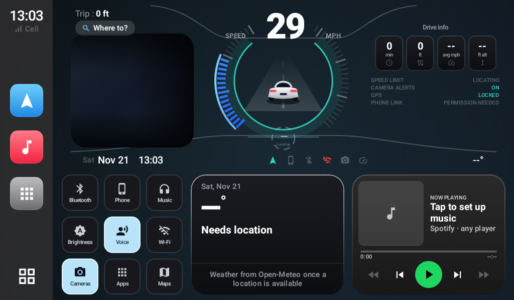
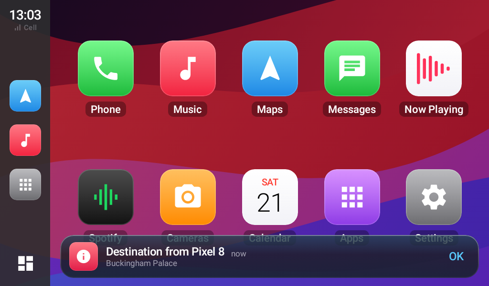
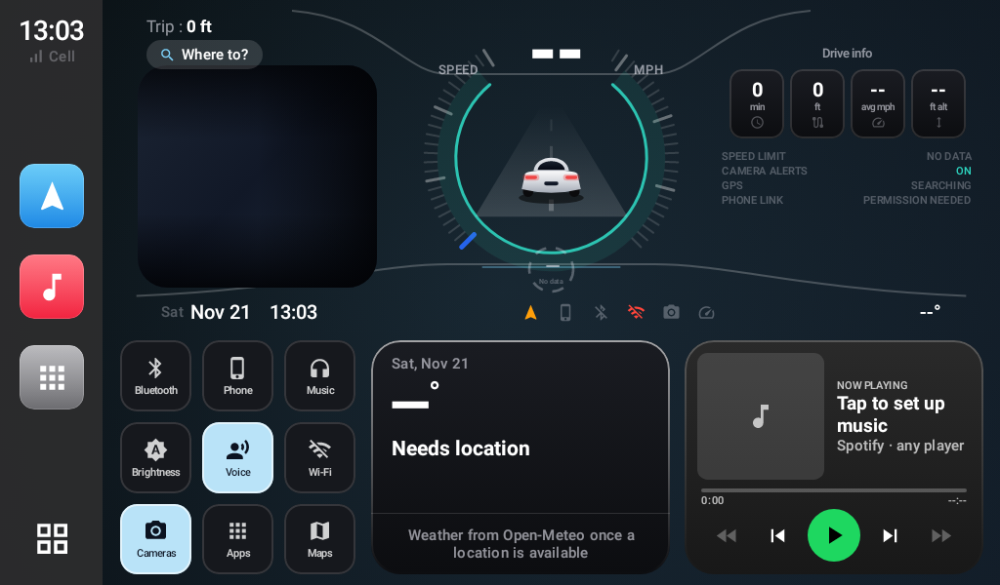
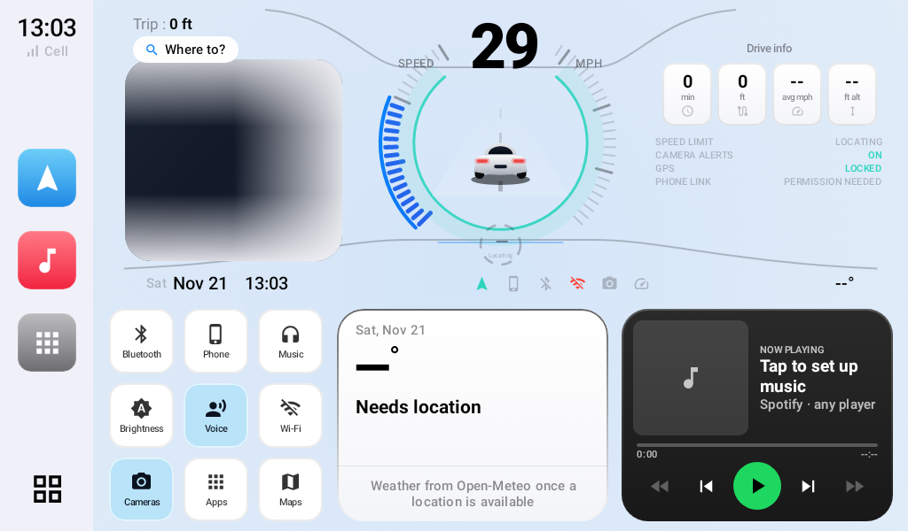
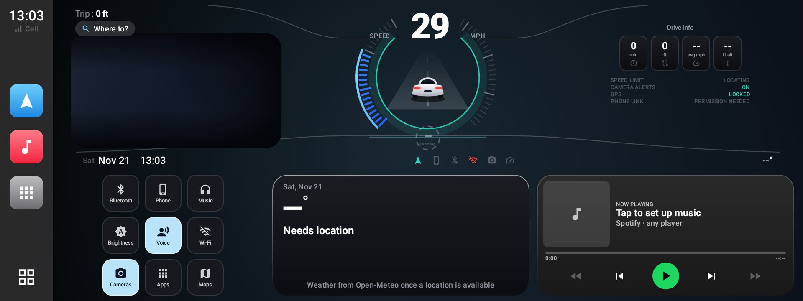
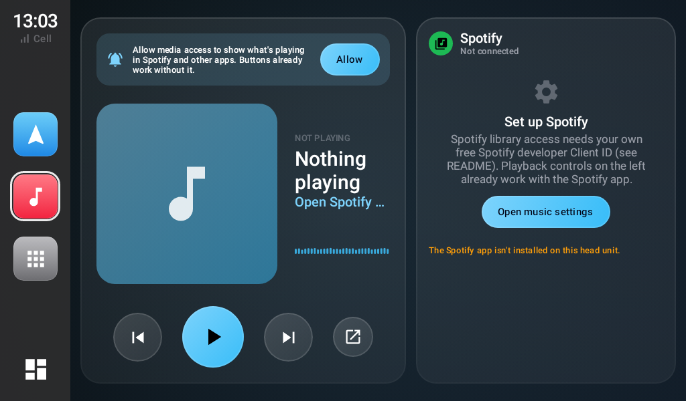
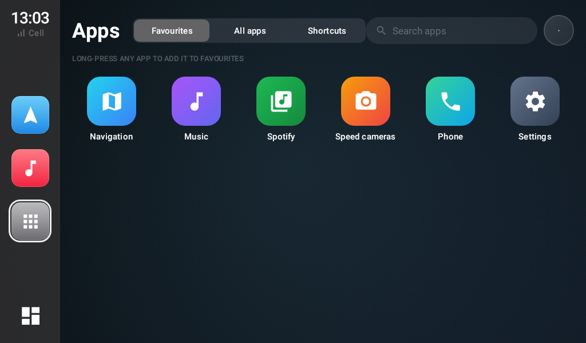
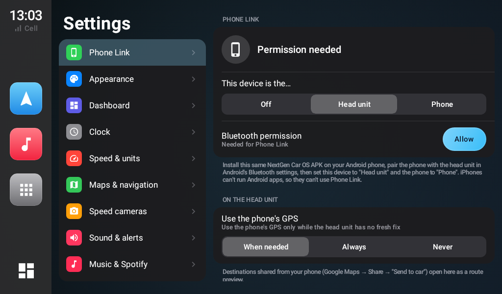
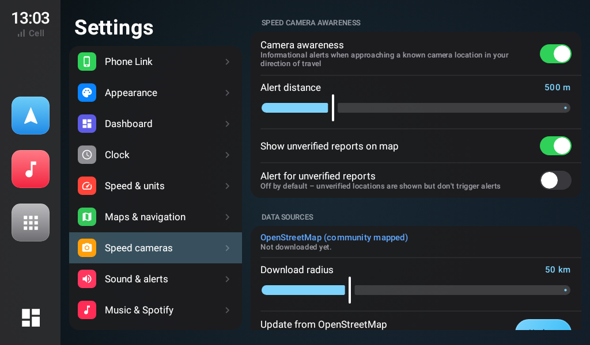

# NextGen Car OS

A premium, iOS-styled dashboard and launcher for **Android car head units** (standard Android 7.0+, landscape touchscreens).
It's built with Kotlin, Jetpack Compose and Material 3 under a custom design system. It doesn't need Google Play Services or Android Automotive OS.



| CarPlay-style app grid & banner | Floating glass tab bar option |
|---|---|
|  |  |

| Light mode | Ultra-wide 1920×720 |
|---|---|
|  |  |

| Music & Spotify | App launcher |
|---|---|
|  |  |

| Phone Link | Speed-camera data sources |
|---|---|
|  |  |

> These screenshots are rendered on the JVM by the project's Robolectric tests (`ScreenshotTest`).
> Maps are native code, so in those tests the map area is a placeholder. On a device it's a live MapLibre map.

---

## What's in it

| Area | What it does | Where the data comes from |
|---|---|---|
| **Cluster home** | Big live speed readout and ring gauge, route summary over a live mini-map, trip computer (time, distance, average speed, altitude), status lights, iOS Control Centre-style tiles, weather card, now-playing card | Device GPS, Open-Meteo, Android MediaSession |
| **Apple-style UI** | CarPlay-style sidebar with time, network and battery (the head unit's own battery if it has one, otherwise your linked phone's), recent apps, and a dashboard ⇄ app-grid toggle. App grid with large squircle icons, a live calendar icon and pill labels. CarPlay-style bottom banners with **OK**. Optional floating Liquid Glass tab bar (*Settings › Dashboard › Navigation bar*). iOS inset-grouped settings, switches and segmented controls, dark and light themes, "Flow" wallpaper | Device status, Phone Link |
| **Spotify-style widgets** | Now-playing cards tinted from the album artwork, green play button, "Playing on Spotify". When nothing plays locally but you're signed in to Spotify, the widgets show what's playing on your account (e.g. on your phone) and control it (Premium) | MediaSession, Spotify Web API `/me/player` |
| **Navigation** | Full-screen MapLibre map, place search, long-press to drop a pin, route overview (distance, duration, ETA), turn-by-turn with spoken guidance, automatic re-routing, Home/Work/recent places, keeps running in the background | OpenStreetMap tiles (OpenFreeMap / CARTO), Photon search, OSRM routing |
| **Speed limits** | Limit of the road you're on, updating as you move between roads. Shows **"No data"** when a road has no mapped limit and never guesses. Over-limit indication with a set tolerance | OpenStreetMap `maxspeed` tags via Overpass |
| **Speed cameras** | Map markers and quiet alerts for cameras ahead in your direction of travel, plus average-speed zone tracking (your average speed inside the zone). Locations are labelled **Verified** (official dataset you imported), **Community mapped** (OpenStreetMap) or **Unverified** (your own reports) | OpenStreetMap download for a radius you choose, CSV import, on-device reports |
| **Music & Spotify** | Now playing, artwork, progress and seek, play/pause/skip, ±15 s, switching between media apps, Spotify playlists (Premium can start playback directly) | Android MediaSession, official Spotify Web API (OAuth PKCE) |
| **Launcher** | Installed apps in an iOS-style grid, favourites, custom shortcuts (web, `tel:`, `geo:`, `spotify:`), app info, optional "use as home screen" | PackageManager |
| **Phone Link** | Bluetooth link to the same app on your Android phone: the phone's GPS (fills in when the head unit's GPS is weak), destinations shared from Google Maps, phone battery, and the next turn sent back to the phone | Bluetooth RFCOMM between the two devices |

### What isn't included
- **Vehicle data** (gear, fuel or battery, tyre pressure, warning lights) – a standard Android head unit doesn't expose these to apps, so the cluster shows only real GPS, trip and app data.
- **A complete or live speed-camera database.** No free, legitimate source of one exists. The app says where its data came from and when, and alerts are informational only. Check that camera-location alerts are legal where you drive (France, Germany and Switzerland restrict them, for example).
- **iPhone Phone Link.** iPhones can't run Android apps. CarPlay is a closed Apple protocol and isn't implemented.
- **The music visualiser** is a decorative "playing" animation, not audio analysis.

---

## 1. Open and build

Requirements: Android Studio Ladybug (2024.2) or newer, JDK 17+, Android SDK 35.

1. In Android Studio choose **File › Open** and select this folder. It syncs with the Gradle wrapper (Gradle 8.11.1, AGP 8.7.3).
2. To build an APK: **Build › Build App Bundle(s) / APK(s) › Build APK(s)**. The file is `app/build/outputs/apk/debug/app-debug.apk`.

From a terminal:

```bash
./gradlew assembleDebug
```

```bash
./gradlew testDebugUnitTest
```

The second command runs the unit and parser tests and writes screenshots to `app/build/screenshots`.

**No Android Studio?** Every push to GitHub runs the **Build APK** workflow (`.github/workflows/build-apk.yml`). Open the run in the repository's **Actions** tab and download the `NextGenCarOS-debug-apk` artifact.

### Signed release build (optional)
Create `keystore.properties` in the project root. It's git-ignored:

```properties
storeFile=nextgen.jks
storePassword=…
keyAlias=nextgen
keyPassword=…
```

Then run:

```bash
./gradlew assembleRelease
```

Without a keystore, release builds are signed with the debug key.

---

## 2. API keys and external services

**No key is needed for maps, search, routing, speed limits, cameras or weather.** The defaults are free public services:

| Service | Used for | Notes |
|---|---|---|
| OpenFreeMap / CARTO basemaps | Map tiles | CARTO is free for non-commercial use. For anything else, pick **Custom style URL** in *Settings › Maps* and paste any MapLibre style, e.g. MapTiler `https://api.maptiler.com/maps/streets-v2-dark/style.json?key=YOUR_KEY` |
| photon.komoot.io | Place search | Fair use |
| router.project-osrm.org | Routing | **Demo server**, no uptime guarantee. For reliability, run your own [OSRM](https://github.com/Project-OSRM/osrm-backend) and set it in *Settings › Maps › Routing server* |
| overpass-api.de | Speed limits, camera data | Endpoint can be changed in *Settings › Maps* |
| api.open-meteo.com | Weather | Free, CC BY 4.0 |

The **only key-like setup is Spotify** (next section). It's optional.

---

## 3. Spotify setup (optional)

Without any setup, **now playing, artwork, progress, play/pause/skip/seek already work with the Spotify app** (and any other player) once you allow *Media access* (see Permissions).
To also browse your playlists inside NextGen Car OS:

1. Go to <https://developer.spotify.com/dashboard> and create an app (any name). Tick **Web API**.
2. Add this **Redirect URI** exactly: `nextgencaros://spotify-callback`
3. Under **User Management**, add the Spotify account(s) that will sign in. This is required while the app is in Spotify's "development mode".
4. Copy the **Client ID**. Then either:
   - paste it into **Settings › Music & Spotify › Spotify Client ID** on the head unit, **or**
   - put `spotify.clientId=YOUR_CLIENT_ID` in `local.properties` before building.
5. Tap **Connect Spotify**. You sign in on Spotify's own page. The app never sees your password; it stores only OAuth tokens, in app-private storage.

| | Free | Premium |
|---|---|---|
| Now playing, controls, seek (via the Spotify app) | ✅ | ✅ |
| Browse your playlists | ✅ | ✅ |
| Start a playlist from NextGen Car OS | Opens it in the Spotify app | ✅ starts directly (Web API) |

---

## 4. Phone Link (Bluetooth)

Phone Link connects the head unit to **the same APK installed on your Android phone**:

| Phone → head unit | Head unit → phone |
|---|---|
| GPS position and speed (used when the head unit has no fresh fix, or always – your choice) | Next turn, distance and ETA while navigating |
| Destinations: in Google Maps (or any app) tap **Share → "Send to car"** | |
| Phone battery level (shown in the status bar) | |

Setup:
1. Pair the phone and the head unit in Android's **Bluetooth settings** (as you would for calls and music).
2. Install `app-debug.apk` on the phone too.
3. On the head unit: **Settings › Phone Link → This device is the… Head unit**. This is the default. Leave NextGen Car OS running.
4. On the phone: **Settings › Phone Link → Phone**, then pick the head unit from the paired-devices list.
5. The status changes to **Connected**. The phone shows an ongoing "Phone Link active" notification so the link keeps working with the screen off.

Shared links are understood from Google Maps (including `maps.app.goo.gl` short links), Apple Maps links, `geo:` links and plain addresses.

---

## 5. Install on your head unit

1. On the head unit, allow installs from unknown sources. This is usually in *Settings › Security* or *Apps › Special access › Install unknown apps* for your file manager. Some units hide it under *Factory settings* (often code `8888`, `1234` or `0000`; check your unit's manual).
2. Copy `app-debug.apk` to a USB stick or SD card. Plug it in, open it in the unit's file manager and tap **Install**.
   Over the network with ADB instead (if the unit has developer options or wireless ADB):

   ```bash
   adb connect <head-unit-ip>:5555
   ```

   ```bash
   adb install -r app/build/outputs/apk/debug/app-debug.apk
   ```

3. Open **NextGen Car OS**. The welcome screen explains each permission, and you can grant them there.
4. Optional: *Settings › Dashboard › Use as home screen*, then press Home and choose NextGen Car OS (**Always**). Some head units have their own "default launcher" setting instead.
5. Many head-unit firmwares aggressively kill background apps. If navigation stops in the background, exclude NextGen Car OS from the unit's "app killer" or battery optimisation list.

---

## 6. Permissions and why they're needed

| Permission | Why |
|---|---|
| Location (fine) | GPS position, speed, current road's speed limit, camera awareness, navigation |
| Foreground service (location, connected device) | Keeps guidance and Phone Link running while another app is in front |
| Notifications (Android 13+) | Android requires the ongoing navigation / Phone Link notification |
| Nearby devices / Bluetooth | Show the connected phone and audio device; Phone Link |
| Notification access ("Media access") | Android's only supported way for a third-party app to read and control other apps' media sessions (Spotify etc.). Notification content isn't read or stored |
| Internet, network state | Map tiles, search, routing, weather, OSM data, Spotify |
| **Accessibility service** | **Not used.** Everything works through normal Android APIs |

---

## Project layout

```
app/src/main/java/com/nextgen/caros/
  NextGenApp.kt           app + dependency container
  MainActivity.kt         single activity, immersive, Spotify redirect
  data/                   DataStore-backed settings (survive restarts)
  location/               LocationManager GPS (no Play Services), geo maths
  speedlimit/             Overpass download, road matching, maxspeed parser
  cameras/                camera DB (OSM / CSV / reports), alert engine
  nav/                    Photon search, OSRM routing, turn-by-turn, foreground service
  media/                  MediaSession reader/controller, notification listener
  spotify/                PKCE OAuth + Web API
  link/                   Phone Link (Bluetooth RFCOMM), share-to-car parser
  trip/ system/ weather/ apps/
  ui/                     Compose UI: theme, glass components, shell, screens
app/src/test/             unit, parser, screenshot (Robolectric) and opt-in live API tests
```

Live API tests (need internet; they call the real public services):

```bash
./gradlew testDebugUnitTest -PliveTests --tests '*LiveApiTest*'
```

## Attribution
Map data © OpenStreetMap contributors (ODbL). Rendering by MapLibre Native. Weather by Open-Meteo.com. Spotify is a trademark of Spotify AB. This project isn't affiliated with Spotify, Apple or Google.
